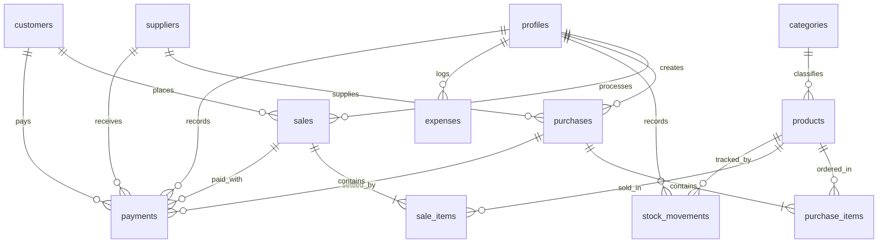

# StockWise — Database Schema Documentation

This document describes the database schema architecture for **StockWise** based on the 12 core tables created manually in the Supabase SQL Editor. 

Because the tables were created directly via the Supabase SQL Editor without migration files committed to this repository, each table specification below details the expected standard columns, data types, keys, constraints, and relationships, along with explicit **Verification & Uncertainty Notes** highlighting design options to confirm against your actual Supabase dashboard.

---

## 1. Entity-Relationship Overview

---

## 2. Table-by-Table Schema Specifications

### 2.1. `profiles`
Stores extended user profile information linked to Supabase authentication (`auth.users`).

* **Primary Key:** `id` (references `auth.users(id)`)
* **Foreign Keys:**
  * `id` → `auth.users(id)` `ON DELETE CASCADE`

| Column | Data Type | Nullable | Default | Constraints / References | Description |
| :--- | :--- | :--- | :--- | :--- | :--- |
| `id` | `UUID` | No | — | `PRIMARY KEY`, `REFERENCES auth.users(id)` | Matches Supabase Auth user UUID |
| `full_name` | `TEXT` | Yes | `NULL` | — | User's display / full name |
| `email` | `TEXT` | Yes | `NULL` | — | Mirrored email address for easy querying |
| `role` | `TEXT` | No | `'staff'` | `CHECK (role IN ('admin', 'manager', 'cashier', 'staff'))` | User permission role within StockWise |
| `phone` | `TEXT` | Yes | `NULL` | — | Contact telephone number |
| `avatar_url` | `TEXT` | Yes | `NULL` | — | URL to user's profile image |
| `created_at` | `TIMESTAMPTZ` | No | `now()` | — | Record creation timestamp |
| `updated_at` | `TIMESTAMPTZ` | No | `now()` | — | Record modification timestamp |

> **Uncertainty & Verification Notes:**
> * Confirm whether `role` is implemented as a PostgreSQL `ENUM` type (`user_role`) or as a `TEXT` field with a `CHECK` constraint.
> * Check whether multi-tenancy / organization scoping (e.g., `tenant_id` or `company_id`) was added.

---

### 2.2. `categories`
Organizes inventory items and products into hierarchical or grouped classifications.

* **Primary Key:** `id`
* **Foreign Keys:** None (or self-referential if hierarchical)

| Column | Data Type | Nullable | Default | Constraints / References | Description |
| :--- | :--- | :--- | :--- | :--- | :--- |
| `id` | `UUID` | No | `gen_random_uuid()` | `PRIMARY KEY` | Unique identifier |
| `name` | `VARCHAR(100)` | No | — | `UNIQUE` | Category title (e.g., "Electronics", "Groceries") |
| `description` | `TEXT` | Yes | `NULL` | — | Optional description of the category |
| `parent_id` | `UUID` | Yes | `NULL` | `REFERENCES categories(id) ON DELETE SET NULL` | *Optional:* for sub-category hierarchies |
| `created_at` | `TIMESTAMPTZ` | No | `now()` | — | Creation timestamp |
| `updated_at` | `TIMESTAMPTZ` | No | `now()` | — | Last update timestamp |

> **Uncertainty & Verification Notes:**
> * Confirm whether `id` is a `UUID` (`gen_random_uuid()`) or an `IDENTITY BIGINT`.
> * Check if `parent_id` was included for nested categories or if categories are flat.

---

### 2.3. `products`
The central catalog of goods, containing pricing, inventory thresholds, and identifiers.

* **Primary Key:** `id`
* **Foreign Keys:**
  * `category_id` → `categories(id)` `ON DELETE SET NULL`

| Column | Data Type | Nullable | Default | Constraints / References | Description |
| :--- | :--- | :--- | :--- | :--- | :--- |
| `id` | `UUID` | No | `gen_random_uuid()` | `PRIMARY KEY` | Unique product identifier |
| `name` | `TEXT` | No | — | — | Product name |
| `sku` | `VARCHAR(100)` | Yes | `NULL` | `UNIQUE` | Stock Keeping Unit code |
| `barcode` | `VARCHAR(100)` | Yes | `NULL` | `UNIQUE` | Scannable barcode (UPC / EAN) |
| `category_id` | `UUID` | Yes | `NULL` | `REFERENCES categories(id)` | Associated category |
| `cost_price` | `NUMERIC(12, 2)`| No | `0.00` | `CHECK (cost_price >= 0)` | Purchase/acquisition cost per unit |
| `selling_price`| `NUMERIC(12, 2)`| No | `0.00` | `CHECK (selling_price >= 0)` | Standard retail selling price |
| `stock_quantity`| `INTEGER` | No | `0` | `CHECK (stock_quantity >= 0)` | Current on-hand quantity |
| `min_stock_level`| `INTEGER` | Yes | `5` | `CHECK (min_stock_level >= 0)` | Alert threshold for low-stock warnings |
| `unit` | `VARCHAR(20)` | Yes | `'pcs'` | — | Unit of measurement (e.g., pcs, kg, box) |
| `image_url` | `TEXT` | Yes | `NULL` | — | Product visual / photo URL |
| `status` | `TEXT` | No | `'active'` | `CHECK (status IN ('active', 'inactive', 'archived'))` | Operational status |
| `created_at` | `TIMESTAMPTZ` | No | `now()` | — | Creation timestamp |
| `updated_at` | `TIMESTAMPTZ` | No | `now()` | — | Last update timestamp |

> **Uncertainty & Verification Notes:**
> * Verify whether `stock_quantity` is updated via database triggers on `stock_movements` or directly mutated by application services.
> * If weighted/bulk items are sold, check if `stock_quantity` is `NUMERIC(12, 3)` instead of `INTEGER`.

---

### 2.4. `customers`
Clients and buyers who purchase products from the store.

* **Primary Key:** `id`
* **Foreign Keys:** None

| Column | Data Type | Nullable | Default | Constraints / References | Description |
| :--- | :--- | :--- | :--- | :--- | :--- |
| `id` | `UUID` | No | `gen_random_uuid()` | `PRIMARY KEY` | Unique customer identifier |
| `name` | `TEXT` | No | — | — | Customer full name or business title |
| `email` | `VARCHAR(255)` | Yes | `NULL` | — | Contact email address |
| `phone` | `VARCHAR(50)` | Yes | `NULL` | — | Telephone number |
| `address` | `TEXT` | Yes | `NULL` | — | Billing / shipping address |
| `tax_number` | `VARCHAR(50)` | Yes | `NULL` | — | Tax identification number (if B2B) |
| `balance` | `NUMERIC(12, 2)`| No | `0.00` | — | Outstanding receivables balance |
| `created_at` | `TIMESTAMPTZ` | No | `now()` | — | Registration timestamp |
| `updated_at` | `TIMESTAMPTZ` | No | `now()` | — | Last update timestamp |

> **Uncertainty & Verification Notes:**
> * Confirm column name for receivables: `balance`, `current_balance`, or `opening_balance`.
> * Verify whether `email` or `phone` has a `UNIQUE` constraint in your setup.

---

### 2.5. `suppliers`
Vendors and distributors from whom stock is purchased.

* **Primary Key:** `id`
* **Foreign Keys:** None

| Column | Data Type | Nullable | Default | Constraints / References | Description |
| :--- | :--- | :--- | :--- | :--- | :--- |
| `id` | `UUID` | No | `gen_random_uuid()` | `PRIMARY KEY` | Unique supplier identifier |
| `name` | `TEXT` | No | — | — | Supplier company or trade name |
| `contact_person`| `TEXT` | Yes | `NULL` | — | Point of contact representative |
| `email` | `VARCHAR(255)` | Yes | `NULL` | — | Contact email |
| `phone` | `VARCHAR(50)` | Yes | `NULL` | — | Contact phone number |
| `address` | `TEXT` | Yes | `NULL` | — | Physical / billing address |
| `tax_number` | `VARCHAR(50)` | Yes | `NULL` | — | Business tax / VAT registration ID |
| `balance` | `NUMERIC(12, 2)`| No | `0.00` | — | Outstanding payable balance to vendor |
| `created_at` | `TIMESTAMPTZ` | No | `now()` | — | Registration timestamp |
| `updated_at` | `TIMESTAMPTZ` | No | `now()` | — | Last update timestamp |

> **Uncertainty & Verification Notes:**
> * Confirm whether payables are tracked directly on `balance` or derived dynamically via `purchases` and `payments`.

---

### 2.6. `purchases`
Header record for stock intake orders and vendor invoices.

* **Primary Key:** `id`
* **Foreign Keys:**
  * `supplier_id` → `suppliers(id)` `ON DELETE RESTRICT`
  * `created_by` → `profiles(id)` `ON DELETE SET NULL`

| Column | Data Type | Nullable | Default | Constraints / References | Description |
| :--- | :--- | :--- | :--- | :--- | :--- |
| `id` | `UUID` | No | `gen_random_uuid()` | `PRIMARY KEY` | Purchase transaction ID |
| `purchase_number`| `VARCHAR(100)`| No | — | `UNIQUE` | Human-readable PO number (e.g., `PO-2026-0001`) |
| `supplier_id` | `UUID` | No | — | `REFERENCES suppliers(id)` | Associated vendor |
| `purchase_date`| `DATE` | No | `CURRENT_DATE` | — | Date of purchase invoice/order |
| `total_amount` | `NUMERIC(12, 2)`| No | `0.00` | `CHECK (total_amount >= 0)` | Net invoice total |
| `paid_amount` | `NUMERIC(12, 2)`| No | `0.00` | `CHECK (paid_amount >= 0)` | Total paid so far |
| `due_amount` | `NUMERIC(12, 2)`| No | `0.00` | — | Outstanding amount (`total_amount - paid_amount`) |
| `status` | `TEXT` | No | `'received'` | `CHECK (status IN ('ordered', 'received', 'pending', 'cancelled'))` | Fulfillment status |
| `payment_status`| `TEXT` | No | `'unpaid'` | `CHECK (payment_status IN ('paid', 'partial', 'unpaid'))` | Financial status |
| `notes` | `TEXT` | Yes | `NULL` | — | Purchase remarks or shipping notes |
| `created_by` | `UUID` | Yes | `NULL` | `REFERENCES profiles(id)` | User who recorded the purchase |
| `created_at` | `TIMESTAMPTZ` | No | `now()` | — | Creation timestamp |
| `updated_at` | `TIMESTAMPTZ` | No | `now()` | — | Last update timestamp |

> **Uncertainty & Verification Notes:**
> * Check identifier column name: `purchase_number`, `po_number`, or `invoice_number`.
> * Verify whether `due_amount` is a stored column or a generated column (`GENERATED ALWAYS AS (total_amount - paid_amount) STORED`).
> * Check if separate `tax_amount` and `discount_amount` columns exist on the header.

---

### 2.7. `purchase_items`
Individual line items specifying products and quantities for a purchase.

* **Primary Key:** `id`
* **Foreign Keys:**
  * `purchase_id` → `purchases(id)` `ON DELETE CASCADE`
  * `product_id` → `products(id)` `ON DELETE RESTRICT`

| Column | Data Type | Nullable | Default | Constraints / References | Description |
| :--- | :--- | :--- | :--- | :--- | :--- |
| `id` | `UUID` | No | `gen_random_uuid()` | `PRIMARY KEY` | Line item identifier |
| `purchase_id` | `UUID` | No | — | `REFERENCES purchases(id) ON DELETE CASCADE` | Parent purchase transaction |
| `product_id` | `UUID` | No | — | `REFERENCES products(id)` | Purchased product |
| `quantity` | `INTEGER` | No | — | `CHECK (quantity > 0)` | Quantity received |
| `unit_cost` | `NUMERIC(12, 2)`| No | — | `CHECK (unit_cost >= 0)` | Price paid per unit |
| `subtotal` | `NUMERIC(12, 2)`| No | — | `CHECK (subtotal >= 0)` | Line subtotal (`quantity * unit_cost`) |
| `created_at` | `TIMESTAMPTZ` | No | `now()` | — | Creation timestamp |

> **Uncertainty & Verification Notes:**
> * Confirm column naming: `unit_cost` vs `unit_price`, `subtotal` vs `total_cost`.
> * Check whether a unique constraint exists on `(purchase_id, product_id)`.

---

### 2.8. `sales`
Header record for customer sales transactions, orders, and POS receipts.

* **Primary Key:** `id`
* **Foreign Keys:**
  * `customer_id` → `customers(id)` `ON DELETE SET NULL`
  * `created_by` → `profiles(id)` `ON DELETE SET NULL`

| Column | Data Type | Nullable | Default | Constraints / References | Description |
| :--- | :--- | :--- | :--- | :--- | :--- |
| `id` | `UUID` | No | `gen_random_uuid()` | `PRIMARY KEY` | Sale transaction identifier |
| `invoice_number`| `VARCHAR(100)`| No | — | `UNIQUE` | Unique invoice code (e.g., `INV-2026-0001`) |
| `customer_id` | `UUID` | Yes | `NULL` | `REFERENCES customers(id)` | Customer (nullable for guest/walk-in POS) |
| `sale_date` | `DATE` | No | `CURRENT_DATE` | — | Date of sale |
| `subtotal` | `NUMERIC(12, 2)`| No | `0.00` | `CHECK (subtotal >= 0)` | Total before taxes & discounts |
| `discount_amount`| `NUMERIC(12, 2)`| No | `0.00` | `CHECK (discount_amount >= 0)` | Applied discount |
| `tax_amount` | `NUMERIC(12, 2)`| No | `0.00` | `CHECK (tax_amount >= 0)` | Applied VAT / sales tax |
| `total_amount` | `NUMERIC(12, 2)`| No | `0.00` | `CHECK (total_amount >= 0)` | Net payable amount |
| `status` | `TEXT` | No | `'completed'`| `CHECK (status IN ('draft', 'completed', 'cancelled', 'refunded'))` | Order lifecycle status |
| `notes` | `TEXT` | Yes | `NULL` | — | Order notes or customer instructions |
| `created_by` | `UUID` | Yes | `NULL` | `REFERENCES profiles(id)` | Cashier / staff member who made the sale |
| `created_at` | `TIMESTAMPTZ` | No | `now()` | — | Record creation timestamp |
| `updated_at` | `TIMESTAMPTZ` | No | `now()` | — | Last modification timestamp |

> **Uncertainty & Verification Notes:**
> * Confirm whether `customer_id` is nullable to allow walk-in sales without registering a customer profile.
> * Confirm if `payment_method` is stored directly on `sales` or exclusively tracked via the `payments` table.
> * Total paid, due, and payment status are derived from related `payments` records; `sales` stores none of these payment summary columns.

---

### 2.9. `sale_items`
Individual line items indicating products, quantities, and selling prices for a sale.

* **Primary Key:** `id`
* **Foreign Keys:**
  * `sale_id` → `sales(id)` `ON DELETE CASCADE`
  * `product_id` → `products(id)` `ON DELETE RESTRICT`

| Column | Data Type | Nullable | Default | Constraints / References | Description |
| :--- | :--- | :--- | :--- | :--- | :--- |
| `id` | `UUID` | No | `gen_random_uuid()` | `PRIMARY KEY` | Line item identifier |
| `sale_id` | `UUID` | No | — | `REFERENCES sales(id) ON DELETE CASCADE` | Associated sale |
| `product_id` | `UUID` | No | — | `REFERENCES products(id)` | Sold product |
| `quantity` | `INTEGER` | No | — | `CHECK (quantity > 0)` | Sold quantity |
| `unit_price` | `NUMERIC(12, 2)`| No | — | `CHECK (unit_price >= 0)` | Price charged per unit |
| `subtotal` | `NUMERIC(12, 2)`| No | — | `CHECK (subtotal >= 0)` | Line total (`quantity * unit_price`) |
| `created_at` | `TIMESTAMPTZ` | No | `now()` | — | Creation timestamp |

> **Uncertainty & Verification Notes:**
> * Check if item-level discount (`discount_amount`) or snapshot of unit cost (`cost_price` for profit reporting) exists on this table.

---

### 2.10. `stock_movements`
The audit ledger tracking every stock addition, reduction, transfer, or correction.

* **Primary Key:** `id`
* **Foreign Keys:**
  * `product_id` → `products(id)` `ON DELETE CASCADE`
  * `created_by` → `profiles(id)` `ON DELETE SET NULL`

| Column | Data Type | Nullable | Default | Constraints / References | Description |
| :--- | :--- | :--- | :--- | :--- | :--- |
| `id` | `UUID` | No | `gen_random_uuid()` | `PRIMARY KEY` | Movement entry identifier |
| `product_id` | `UUID` | No | — | `REFERENCES products(id)` | Affected product |
| `type` | `TEXT` | No | — | `CHECK (type IN ('in', 'out', 'adjustment', 'purchase', 'sale', 'return', 'damaged'))` | Reason / flow direction |
| `quantity` | `INTEGER` | No | — | — | Quantity moved (signed or unsigned) |
| `previous_stock`| `INTEGER` | Yes | `NULL` | — | Stock level before movement |
| `current_stock` | `INTEGER` | Yes | `NULL` | — | Stock level after movement |
| `reference_id` | `UUID` | Yes | `NULL` | — | ID of related record (`sales.id`, `purchases.id`, etc.) |
| `notes` | `TEXT` | Yes | `NULL` | — | Reason or adjustment comments |
| `created_by` | `UUID` | Yes | `NULL` | `REFERENCES profiles(id)` | Staff member who performed the action |
| `created_at` | `TIMESTAMPTZ` | No | `now()` | — | Timestamp of stock change |

> **Uncertainty & Verification Notes:**
> * Confirm column name: `type` vs `movement_type`.
> * Verify sign convention: whether `quantity` is always positive (with `type` indicating direction) or positive for inbound / negative for outbound.
> * Check whether `reference_type` (`'sale'`, `'purchase'`, `'manual'`) is used alongside `reference_id`.

---

### 2.11. `payments`
Tracks monetary receipts and disbursements linked to sales, purchases, or customer/supplier balances.

* **Primary Key:** `id`
* **Foreign Keys:**
  * `sale_id` → `sales(id)` `ON DELETE SET NULL`
  * `purchase_id` → `purchases(id)` `ON DELETE SET NULL`
  * `customer_id` → `customers(id)` `ON DELETE SET NULL`
  * `supplier_id` → `suppliers(id)` `ON DELETE SET NULL`
  * `created_by` → `profiles(id)` `ON DELETE SET NULL`

| Column | Data Type | Nullable | Default | Constraints / References | Description |
| :--- | :--- | :--- | :--- | :--- | :--- |
| `id` | `UUID` | No | `gen_random_uuid()` | `PRIMARY KEY` | Payment transaction ID |
| `payment_type` | `TEXT` | No | — | `CHECK (payment_type IN ('inward', 'outward', 'sale', 'purchase'))` | Flow direction |
| `sale_id` | `UUID` | Yes | `NULL` | `REFERENCES sales(id)` | Associated customer sale (if applicable) |
| `purchase_id` | `UUID` | Yes | `NULL` | `REFERENCES purchases(id)` | Associated purchase invoice (if applicable) |
| `customer_id` | `UUID` | Yes | `NULL` | `REFERENCES customers(id)` | Associated customer |
| `supplier_id` | `UUID` | Yes | `NULL` | `REFERENCES suppliers(id)` | Associated supplier |
| `amount` | `NUMERIC(12, 2)`| No | — | `CHECK (amount > 0)` | Payment currency amount |
| `payment_date` | `DATE` | No | `CURRENT_DATE` | — | Date payment occurred |
| `payment_method`| `TEXT` | No | `'cash'` | `CHECK (payment_method IN ('cash', 'card', 'bank_transfer', 'mobile_money', 'cheque', 'other'))` | Method used |
| `reference_number`| `TEXT` | Yes | `NULL` | — | Receipt, voucher, transfer, or payment request reference |
| `notes` | `TEXT` | Yes | `NULL` | — | Additional payment memo |
| `created_by` | `UUID` | Yes | `NULL` | `REFERENCES profiles(id)` | Staff member who received/issued payment |
| `created_at` | `TIMESTAMPTZ` | No | `now()` | — | Creation timestamp |

> **Uncertainty & Verification Notes:**
> * Confirm whether dedicated foreign keys (`sale_id`, `purchase_id`) were created or if a polymorphic reference pattern was used.
> * Verify exact list of allowed `payment_method` and `payment_type` values.

---

### 2.12. `expenses`
Records day-to-day business operational expenditures (utilities, salaries, rent, packaging).

* **Primary Key:** `id`
* **Foreign Keys:**
  * `created_by` → `profiles(id)` `ON DELETE SET NULL`

| Column | Data Type | Nullable | Default | Constraints / References | Description |
| :--- | :--- | :--- | :--- | :--- | :--- |
| `id` | `UUID` | No | `gen_random_uuid()` | `PRIMARY KEY` | Expense record ID |
| `title` | `TEXT` | No | — | — | Short expense title (e.g., "Electricity bill") |
| `category` | `VARCHAR(100)` | No | — | — | Expense category (e.g., "Rent", "Utilities") |
| `amount` | `NUMERIC(12, 2)`| No | — | `CHECK (amount > 0)` | Amount spent |
| `expense_date` | `DATE` | No | `CURRENT_DATE` | — | Date expense was incurred |
| `payment_method`| `TEXT` | Yes | `'cash'` | — | Payment method used |
| `reference_number`| `TEXT` | Yes | `NULL` | — | Bill / voucher / receipt reference |
| `receipt_url` | `TEXT` | Yes | `NULL` | — | Uploaded receipt attachment link |
| `notes` | `TEXT` | Yes | `NULL` | — | Additional expense details |
| `created_by` | `UUID` | Yes | `NULL` | `REFERENCES profiles(id)` | Staff member who logged the expense |
| `created_at` | `TIMESTAMPTZ` | No | `now()` | — | Creation timestamp |
| `updated_at` | `TIMESTAMPTZ` | No | `now()` | — | Last update timestamp |

> **Uncertainty & Verification Notes:**
> * Confirm whether `category` is a plain text column or references a separate lookup table.
> * Check if `receipt_url` or attachment storage column exists in your schema.

---

## 3. Relationships Summary Matrix

| Parent Table | Child Table | Foreign Key Column | Cardinality | Cascade Action |
| :--- | :--- | :--- | :--- | :--- |
| `auth.users` | `profiles` | `profiles.id` | 1 : 1 | `ON DELETE CASCADE` |
| `categories` | `products` | `products.category_id` | 1 : N | `ON DELETE SET NULL` |
| `suppliers` | `purchases` | `purchases.supplier_id` | 1 : N | `ON DELETE RESTRICT` |
| `purchases` | `purchase_items` | `purchase_items.purchase_id` | 1 : N | `ON DELETE CASCADE` |
| `products` | `purchase_items` | `purchase_items.product_id` | 1 : N | `ON DELETE RESTRICT` |
| `customers` | `sales` | `sales.customer_id` | 1 : N | `ON DELETE SET NULL` |
| `sales` | `sale_items` | `sale_items.sale_id` | 1 : N | `ON DELETE CASCADE` |
| `products` | `sale_items` | `sale_items.product_id` | 1 : N | `ON DELETE RESTRICT` |
| `products` | `stock_movements`| `stock_movements.product_id` | 1 : N | `ON DELETE CASCADE` |
| `sales` | `payments` | `payments.sale_id` | 1 : N | `ON DELETE SET NULL` |
| `purchases` | `payments` | `payments.purchase_id` | 1 : N | `ON DELETE SET NULL` |
| `customers` | `payments` | `payments.customer_id` | 1 : N | `ON DELETE SET NULL` |
| `suppliers` | `payments` | `payments.supplier_id` | 1 : N | `ON DELETE SET NULL` |
| `profiles` | `sales` | `sales.created_by` | 1 : N | `ON DELETE SET NULL` |
| `profiles` | `purchases` | `purchases.created_by` | 1 : N | `ON DELETE SET NULL` |
| `profiles` | `stock_movements`| `stock_movements.created_by` | 1 : N | `ON DELETE SET NULL` |
| `profiles` | `expenses` | `expenses.created_by` | 1 : N | `ON DELETE SET NULL` |
| `profiles` | `payments` | `payments.created_by` | 1 : N | `ON DELETE SET NULL` |

---

## 4. Recommended Supabase Indexes & Performance Guidelines

To maintain fast query response times as data scales, verify that the following foreign keys and search fields have indexes in Supabase:

1. **`products`**:
   * `CREATE INDEX idx_products_category_id ON products(category_id);`
   * `CREATE INDEX idx_products_sku ON products(sku);`
   * `CREATE INDEX idx_products_barcode ON products(barcode);`
2. **`sales` & `sale_items`**:
   * `CREATE INDEX idx_sales_customer_id ON sales(customer_id);`
   * `CREATE INDEX idx_sales_sale_date ON sales(sale_date);`
   * `CREATE INDEX idx_sale_items_sale_id ON sale_items(sale_id);`
   * `CREATE INDEX idx_sale_items_product_id ON sale_items(product_id);`
3. **`purchases` & `purchase_items`**:
   * `CREATE INDEX idx_purchases_supplier_id ON purchases(supplier_id);`
   * `CREATE INDEX idx_purchase_items_purchase_id ON purchase_items(purchase_id);`
   * `CREATE INDEX idx_purchase_items_product_id ON purchase_items(product_id);`
4. **`stock_movements`**:
   * `CREATE INDEX idx_stock_movements_product_id ON stock_movements(product_id);`
   * `CREATE INDEX idx_stock_movements_created_at ON stock_movements(created_at);`
5. **`payments`**:
   * `CREATE INDEX idx_payments_sale_id ON payments(sale_id);`
   * `CREATE INDEX idx_payments_purchase_id ON payments(purchase_id);`
